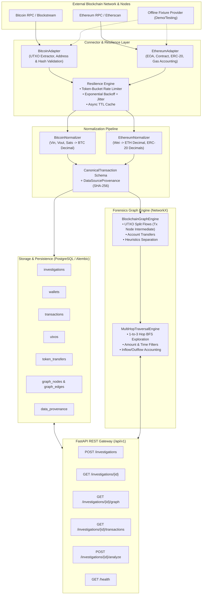

# CryptoTrace — Backend Architecture & System Design Document
## Subsystem: Blockchain Data Foundation & Forensic Engine
**Author:** Role 1 — Senior Blockchain Backend Engineer, Python Backend Architect & Data Specialist  
**Target Audience:** Engineering Team (Role 2: ML/Forensics, Role 3: Threat Intelligence, Role 4: Frontend)

---

## 1. Executive Summary & Service Boundaries

CryptoTrace is an enterprise-grade multi-chain blockchain forensics, transaction graph analysis, and threat intelligence system. As the owner of the **Blockchain Data Foundation**, this subsystem is exclusively responsible for:

1. **Multi-chain Ingestion**: High-throughput, resilient adapters for Bitcoin (UTXO) and Ethereum (Account/EVM).
2. **Canonical Normalization**: Standardizing raw, disparate payloads into strictly typed Decimal monetary values while preserving chain-specific semantics.
3. **Graph Engine & Traversal**: Constructing chain-aware directed forensic graphs in NetworkX with bounded multi-hop traversal (1 to 3 hops) and flow analysis.
4. **Data Persistence & Alembic Migrations**: Fully indexed PostgreSQL schemas with composite indexes for investigations, wallets, transactions, UTXOs, token transfers, graph structures, and provenance records.
5. **REST API Gateway**: FastAPI v1 endpoints with OpenAPI 3.1 documentation, request/response validation, global error handling, and structured logging.
6. **Data Provenance & Reliability**: Cryptographic SHA-256 payload auditing, rate limiting, bounded exponential backoff retries, and deterministic offline fixture fallback.

---

## 2. Shared Integration Contracts

To ensure decoupled collaboration, public contracts are defined in `cryptotrace.schemas.contracts` and frozen for consumer integration:

### Role 2: Machine Learning & Forensic Detection
- **`GraphNode` & `GraphEdge`**: Schema for nodes (Wallets, Transactions, Contracts, Services) and edges (Confirmed Transfer, UTXO Input/Output, ERC-20 Transfer, Heuristic Co-Spend).
- **`TransactionGraph`**: Network topology containing nodes, edges, root identifier, and applied filter metadata.
- **`CanonicalTransaction`**: Complete normalized transaction with input/output arrays and gas/fee metrics.

### Role 3: Threat Intelligence & Risk Scoring
- **`CanonicalTransaction`**: Universal transaction representation across chains.
- **`DataSourceProvenance`**: Cryptographic audit record including `provider_name`, `retrieved_at`, `is_fixture`, and `raw_payload_hash` (SHA-256).
- **`TokenTransfer`**: Standardized ERC-20 log transfers with contract address, token symbol, decimals, and formatted Decimal value.

### Role 4: Web Frontend Client
- **`InvestigationCreate`**: Input payload to initialize an investigation.
- **`InvestigationResponse`**: Investigation metadata, status (`created`, `ingesting`, `completed`, `failed`), and stats.
- **`PaginatedResponse[TransactionSummary]`**: Standard envelope for paginated transaction listings.
- **`InvestigationAnalyzeResponse`**: On-demand re-analysis results including node/edge counts and `FlowAnalysis` (net flow, inflow, outflow, top counterparties).

---

## 3. Blockchain Connector & Data Ingestion Architecture

### 3.1 Bitcoin Architecture (UTXO-Centric)
Bitcoin does not follow account balances; transactions consume previous transaction outputs (`vin`) and produce new outputs (`vout`).
- **No False Attribution**: Traditional naive scrapers attempt to draw direct 1-to-1 edges from an input to an output. When a transaction consumes multiple inputs (e.g. Input A: 1.5 BTC, Input B: 2.5 BTC) and creates multiple outputs (Output C: 3.2 BTC, Output D: 0.8 BTC change), attributing Input A directly to Output C is forensically inaccurate.
- **Graph Topology**: CryptoTrace models Bitcoin transactions by creating:
  1. Wallet nodes for each unique input address.
  2. An intermediate **Transaction Node** (`tx:<tx_hash>`).
  3. Wallet/service nodes for each unique output address.
  4. Directed edges: `Input Address` $\rightarrow$ `Tx Node` (`UTXO_INPUT`) and `Tx Node` $\rightarrow$ `Output Address` (`UTXO_OUTPUT`).
- **Heuristic Separation**: Inferred heuristics (such as Common-Input Ownership / Co-Spend heuristic) are explicitly labeled with `is_heuristic=True` and `is_confirmed=False`. Heuristic relationships are never presented as confirmed on-chain transfers.

### 3.2 Ethereum Architecture (Account-Based)
Ethereum maintains state balances across EOAs (Externally Owned Accounts) and Contract Accounts.
- **Native Transfers**: Represented as direct directed edges `from_address` $\rightarrow$ `to_address` (`CONFIRMED_TRANSFER`).
- **ERC-20 Token Transfers**: Emitted event logs (`Transfer(address,address,uint256)`) are normalized into `TokenTransfer` schemas and converted into dedicated `ERC20_TRANSFER` edges carrying token symbol and decimal-adjusted amounts.
- **Contract Interactions**: Interactions without token transfers or with raw bytecode inputs are typed as `CONTRACT_CALL` edges.

### 3.3 Extensible Provider Architecture & Reliability
- **`BaseBlockchainAdapter`**: Abstract base class requiring address/hash validation, balance lookups, transaction queries, and block details.
- **Configurable Credentials**: Credentials (`ETHERSCAN_API_KEY`, `ALCHEMY_API_KEY`, `INFURA_PROJECT_ID`) are read strictly from environment variables via Pydantic settings.
- **Rate-Limiting & Retries**: External calls pass through `AsyncRateLimiter` (token-bucket) and `execute_with_retry` (bounded exponential backoff with random jitter).
- **Demo Fixture Mode**: When upstream API keys are absent or `DEMO_FIXTURE_MODE=True`, the connectors safely route to `BitcoinMockAdapter` and `EthereumMockAdapter`. Real blockchain data is never silently fabricated; all fixture data is tagged `is_fixture=True`.

---

## 4. Normalization & Monetary Precision

Monetary values in cryptocurrency represent critical financial evidence:
- **No Floating-Point Operations**: Python `float` suffers from binary representation errors (e.g., `0.1 + 0.2 != 0.3`).
- **Exact Decimal Arithmetic**:
  - Bitcoin: Satoshis (integer) $\rightarrow$ $\text{BTC} = \text{Decimal}(sats) / \text{Decimal}(10^8)$.
  - Ethereum Native: Wei (integer) $\rightarrow$ $\text{ETH} = \text{Decimal}(wei) / \text{Decimal}(10^{18})$.
  - ERC-20 Tokens: Raw value (string integer) $\rightarrow$ $\text{Amount} = \text{Decimal}(raw\_value) / \text{Decimal}(10^{decimals})$.
- All amounts in database columns use `Numeric(38, 18)` or `Numeric(38, 8)`.

---

## 5. NetworkX Graph Forensics & Traversal Engine

The graph engine leverages `networkx.MultiDiGraph` to support parallel transactions between identical counterparties.

### 5.1 Multi-Hop Traversal Algorithm
Given a seed address and depth $K \in [1, 3]$:
1. **BFS Neighborhood Discovery**:
   - Outgoing traversal (forward flow).
   - Incoming traversal (fund source backtracking).
   - Bidirectional traversal (`direction='both'`).
2. **Cycle Prevention**: Visited node paths prevent infinite loops in circular mixing transactions.
3. **Induced Subgraph Extraction**: Extracts all discovered nodes and confirmed/heuristic edges.
4. **Flow Accounting**: Aggregates `total_inflow`, `total_outflow`, `net_flow`, counterparty counts, and ranks top 5 funding sources and outflow destinations.

---

## 6. PostgreSQL Database Schema & Indexing Strategy

Alembic migration `0001_initial_crypto_trace_schema.py` establishes 9 normalized tables:

| Table | Purpose | Critical Indexes |
|---|---|---|
| `investigations` | Case metadata, configuration, and execution counters | `(blockchain, target_address)`, `status` |
| `wallets` | Distinct entity addresses, balances, and tag profiles | `UNIQUE(blockchain, address)`, `(blockchain, node_type)` |
| `transactions` | Universal canonical transactions | `UNIQUE(blockchain, tx_hash)`, `(blockchain, block_number, timestamp)`, `(from_address, to_address)` |
| `utxos` | Unspent and spent Bitcoin transaction outputs | `UNIQUE(tx_hash, vout)`, `(address, is_spent)` |
| `token_transfers` | ERC-20 transfer logs | `(from_address, to_address)`, `(token_address, token_symbol)` |
| `graph_nodes` | Cached nodes per investigation | `UNIQUE(investigation_id, node_id)` |
| `graph_edges` | Cached directed edges per investigation | `(investigation_id, source_id, target_id)`, `tx_hash` |
| `investigation_paths` | Discovered multi-hop paths | `(investigation_id, hop_count)` |
| `data_provenance` | Auditable source provenance records | `(record_type, record_identifier)`, `(provider_name, retrieved_at)` |

---

## 7. API Specification & Status Codes

All endpoints conform to `/api/v1` versioning:

- `POST /api/v1/investigations` (201 Created): Initializes case, executes multi-hop ingestion, builds initial graph.
- `GET /api/v1/investigations/{id}` (200 OK / 404 Not Found): Retrieves case summary.
- `GET /api/v1/investigations/{id}/graph` (200 OK): Returns NetworkX-constructed nodes and edges.
- `GET /api/v1/investigations/{id}/transactions` (200 OK): Paginated transaction list with asset filtering.
- `POST /api/v1/investigations/{id}/analyze` (200 OK): Triggers re-analysis with custom filters and generates flow metrics.
- `GET /health` (200 OK): Health status of API engine and database connectivity.

---

## 8. Verification & Test Suite Summary

The backend includes a comprehensive 34-test Pytest suite:
- `test_bitcoin_connector.py`: Address/hash validation, multi-input multi-output parsing, UTXO accounting.
- `test_ethereum_connector.py`: Address/hash validation, native transfers, ERC-20 event parsing.
- `test_normalization.py`: Strict Decimal precision, missing field error handling, SHA-256 payload hashing.
- `test_graph_engine.py`: NetworkX graph construction, intermediate Tx nodes, 3-hop traversal, disconnected branches, flow analysis.
- `test_database_persistence.py`: SQLAlchemy persistence, foreign key cascades, deduplication.
- `test_api_endpoints.py`: End-to-end FastAPI endpoint verification against schema contracts.
- `test_reliability_resilience.py`: In-memory TTL caching, eviction, token-bucket throttling, exponential backoff retries.
