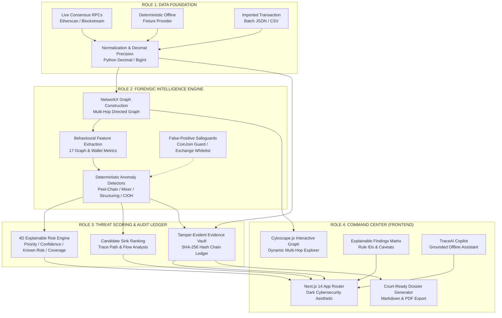
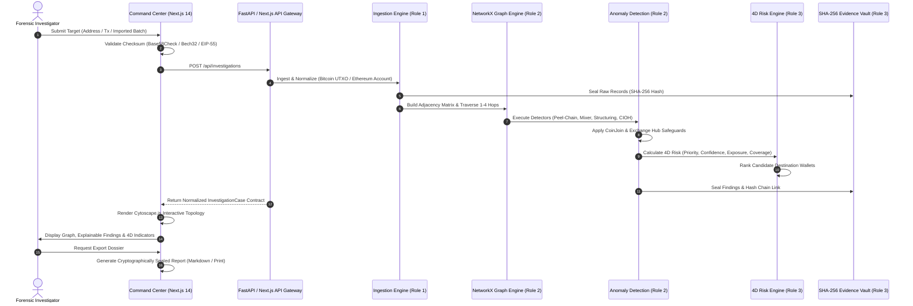

# SOLUTION_ARCHITECTURE.md — Trazen (CryptoTrace)
## System Architecture & Technical Specification
**Team Blizzard** | **Project: Trazen (CryptoTrace)**

---

## 1. High-Level System Architecture

Trazen is structured around four distinct, decoupled subsystems with rigorous separation of concerns, ensuring high modularity, auditable provenance, and offline resilience.

---

## 2. End-to-End Investigation Sequence

---

## 3. Subsystem Breakdown

### Subsystem 1: Role 1 — Data Foundation
- **Multi-Chain Normalization:** Converts heterogenous blockchain models into a standardized contract:
  - *Bitcoin:* Full UTXO accounting (`inputs`, `outputs`, change deduction, explicit transaction intermediate nodes).
  - *Ethereum:* Account-based state machine (`from`, `to`, `nonce`, contract calls, ERC-20 token logs).
- **Exact Monetary Precision:** Strictly avoids IEEE 754 floating point arithmetic. Utilizes Python `Decimal` with database `Numeric(38,18)` precision and TypeScript `BigInt` equivalents.
- **Resilience Engineering:** Upstream rate limiting (token-bucket algorithm), bounded exponential backoff with jitter, async in-memory caching with TTL, and duplicate transaction filtering.
- **Deterministic Offline Fixtures:** Enables 100% offline functionality without external API keys via hardcoded consensus-equivalent test fixtures.

### Subsystem 2: Role 2 — Forensic Intelligence Engine
- **NetworkX Topology Engine:** Directed graph construction supporting multi-hop expansion (1 to 4 hops), cycle detection, and bottleneck analysis.
- **Behavioural Feature Engineering:** 17 cached mathematical metrics per wallet:
  - Inflow/Outflow velocity, net flow, and residual balance ratios
  - Transaction value dispersion (mean, median, coefficient of variation)
  - Maximum dormancy intervals
  - UTXO average input/output counts and address reuse counts
  - EVM contract interaction and ERC-20 token transfer proportions
- **Deterministic Heuristic Detectors:**
  - `CLUSTER-HEURISTIC-01`: Common-Input Ownership Heuristic (CIOH)
  - `CLUSTER-COINJOIN-GUARD-01`: Automatic suppression of CIOH on suspected CoinJoin/PayJoin multi-party transactions (>=3 equal outputs within 0.5% tolerance)
  - `PEEL-CHAIN-01`: Multi-hop forwarding sequences (continuation ratio 0.65-0.995, delay <=24h)
  - `MIXER-PATTERN-01`: Equal-denomination mixing detection excluding verified commercial exchange hubs
  - `STRUCTURING-SPLIT-01`: Burst splitting and threshold avoidance
  - `DORMANT-REACTIVATION-01`: High-velocity liquidation following >=30 days of inactivity

### Subsystem 3: Role 3 — Threat Scoring & Evidence Vault
- **4-Dimensional Risk Model:** Replaces arbitrary single scores with four bounded `[0.0, 1.0]` indicators:
  1. `risk_priority`: Urgency weighting derived from rule severity and finding density.
  2. `attribution_confidence`: Support strength based on confirmed vs inferred edge ratios and counter-evidence.
  3. `known_risk_exposure`: Hop-decayed (`0.55^hop`) proximity to sanctioned or illicit entities.
  4. `investigation_coverage`: Graph completeness factor based on neighborhood completeness.
- **Probable End-Receiver Ranking:** Ranks destination wallets by trace position and volume without falsely asserting human legal identity.
- **Tamper-Evident Evidence Vault:** Cryptographic SHA-256 hash-chaining of all ingested raw payloads, detector hits, and operator modifications. Every block links to `previousRecordHash`, ensuring complete non-repudiation in court.

### Subsystem 4: Role 4 — Command Center (Frontend)
- **Framework:** Next.js 14 App Router, React 18, TypeScript 5, Tailwind CSS.
- **Visualization:** Cytoscape.js interactive graph canvas with custom SVG node glyphs, dynamic breadthfirst layout, and multi-variable edge styling (confirmed vs inferred).
- **TraceAI Copilot:** Evidence-grounded conversational assistant that strictly queries the sealed investigation findings and refuses to hallucinate external data.
- **Dossier Generator:** Client-side generation of cryptographically sealed investigation dossiers in both Markdown and printable PDF formats.

---

## 4. Technology Stack & Component Versioning

| Component | Technology | Version | Purpose |
|---|---|---|---|
| **Backend Framework** | FastAPI | 0.110+ | High-throughput asynchronous REST API |
| **Language Runtime** | Python | 3.12+ | Core backend and forensic processing |
| **ORM & Database** | SQLAlchemy / asyncpg | 2.0+ / 0.29+ | Asynchronous database persistence |
| **Graph Computing** | NetworkX | 3.2+ | Multi-hop directed graph traversal & indexing |
| **Database Engine** | PostgreSQL / SQLite | 16-alpine / 3.40+ | Relational storage for cases, users & evidence |
| **Migrations** | Alembic | 1.13+ | Version-controlled database schema migrations |
| **Frontend Framework** | Next.js | 14.2.35 | Server and client rendered UI with App Router |
| **Graph Visualization** | Cytoscape.js | 3.35.0 | Interactive forensic graph exploration |
| **Styling & Animation** | Tailwind CSS / Framer Motion | 3.4.1 / 14.12.0 | Cybersecurity SOC design system & micro-interactions |
| **Testing** | Pytest / Playwright | 8.0+ / 1.65.0 | Backend unit/integration tests & frontend E2E |
